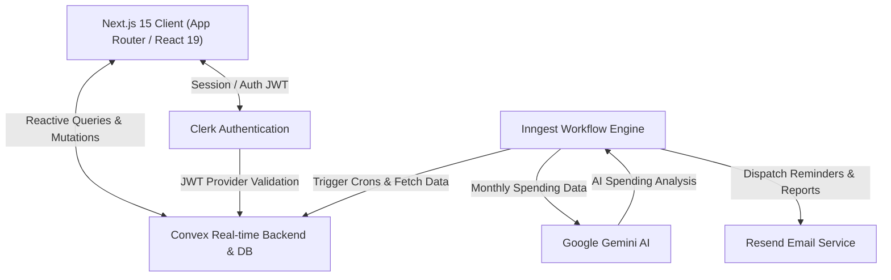

<div align="center">

  

  # 💸 Splitr — Smart Expense Splitting & Settlement Platform

  <p align="center">
    <strong>The smartest, real-time way to track shared expenses, split bills effortlessly, and settle debts with friends, roommates, and groups.</strong>
  </p>

  <p align="center">
    <a href="https://github.com/PMaheshwarreddy/Splitr-Expense-Splitting-Settlement-Platform/stargazers"></a>
    <a href="https://github.com/PMaheshwarreddy/Splitr-Expense-Splitting-Settlement-Platform/network/members"></a>
    <a href="https://github.com/PMaheshwarreddy/Splitr-Expense-Splitting-Settlement-Platform/issues"></a>
    <a href="LICENSE"></a>
    <a href="https://nextjs.org"></a>
    <a href="https://convex.dev"></a>
    <a href="https://clerk.com"></a>
    <a href="https://ai.google.dev"></a>
  </p>

  <p align="center">
    <a href="#-key-features">Features</a> •
    <a href="#-tech-stack">Tech Stack</a> •
    <a href="#-architecture">Architecture</a> •
    <a href="#-getting-started">Getting Started</a> •
    <a href="#-environment-variables">Configuration</a> •
    <a href="#-contributing">Contributing</a> •
    <a href="#-license">License</a>
  </p>

  

</div>

---

## 🌟 Overview

**Splitr** is a modern, open-source expense-splitting and debt settlement web application designed to take the friction out of shared finances. Whether organizing apartment rent with roommates, splitting dinner with friends, or balancing multi-currency vacation costs, Splitr keeps everyone on the exact same page in real time.

Built with **Next.js 15 App Router**, **Convex reactive database**, **Clerk authentication**, **Inngest automated workflows**, and **Google Gemini AI**, Splitr delivers sub-second synchronization, intelligent payment reminders, and automated monthly spending analytics straight to your inbox.

---

## ✨ Key Features

- ⚡ **Real-Time Data Sync:** Powered by Convex's reactive subscriptions — every expense and settlement reflects instantly across all active clients without manual refreshing.
- 👥 **Group & 1-on-1 Expenses:** Organize expenses by project, roommate flat, trip, or record direct one-on-one transactions with individual contacts.
- 🧮 **Multiple Flexible Split Types:**
  - **Equal Split:** Divide amounts equally across selected participants.
  - **Exact Amounts:** Specify exact currency amounts for each individual.
  - **Percentage Split:** Allocate dynamic percentage cuts with precision validation.
- 🤝 **Smart Settlement Engine:** Track payments and record full or partial debt settlements, automatically recalculating net balances.
- 📊 **Dynamic Analytics & Charts:** Interactive visual dashboards built with Recharts displaying total expenditure, monthly trends, and category breakdowns.
- 🤖 **AI-Powered Spending Insights:** Automated monthly cron job using **Google Gemini 1.5 Flash** that reviews your monthly habits and suggests saving opportunities.
- ⏰ **Automated Payment Reminders:** Scheduled background routines via **Inngest** and **Resend** that deliver friendly payment summaries for outstanding debts.
- 🔒 **Enterprise-Grade Authentication:** Flawless user sign-up, sign-in, session management, and social logins powered by Clerk.

---

## 🛠️ Tech Stack

| Layer | Technology | Description |
|---|---|---|
| **Framework** | [Next.js 15](https://nextjs.org/) | App Router, React 19, Turbopack, Server & Client Components |
| **Styling** | [Tailwind CSS v4](https://tailwindcss.com/) | Modern utility-first styling with `@tailwindcss/postcss` |
| **UI Components** | [Radix UI](https://www.radix-ui.com/) & [shadcn/ui](https://ui.shadcn.com/) | Accessible primitives (Dialog, Popover, Select, Avatar, Tabs) |
| **Icons & Visuals** | [Lucide React](https://lucide.dev/) & [Recharts](https://recharts.org/) | Polished icons and interactive charts |
| **Backend & Database** | [Convex](https://convex.dev/) | Real-time document database, serverless backend, search indexes |
| **Authentication** | [Clerk](https://clerk.com/) | User management, session handling, JWT authentication |
| **Background Workflows** | [Inngest](https://www.inngest.com/) | Durable execution engine for crons and payment reminders |
| **Generative AI** | [Google Gemini AI](https://ai.google.dev/) | `gemini-1.5-flash` model for intelligent spending insights |
| **Email Delivery** | [Resend](https://resend.com/) | Transactional email delivery for alerts and digests |

---

## 🏗️ Architecture



---

## 📂 Project Structure

```text
Splitr-Expense-Splitting-Settlement-Platform/
├── app/
│   ├── (auth)/                # Sign-in and sign-up flows (Clerk)
│   ├── (main)/
│   │   ├── dashboard/         # User overview, balance summaries & charts
│   │   ├── expenses/          # Expense creation & category split wizards
│   │   ├── groups/            # Group details, member balances & activity
│   │   ├── person/            # 1-on-1 contact expense ledger
│   │   ├── settlements/       # Payment records & settlement execution
│   │   └── contacts/          # Contacts directory & new group modal
│   ├── api/inngest/           # Inngest API endpoint & background handlers
│   ├── layout.js              # Global application root layout & providers
│   └── page.jsx               # Landing page with hero, features & reviews
├── components/
│   ├── ui/                    # Reusable shadcn/radix UI primitives
│   ├── header.jsx             # Top navigation & user profile dropdown
│   ├── expense-list.jsx       # Transaction histories and filters
│   ├── settlement-list.jsx    # Settlement history view
│   └── convex-client-provider # Convex & Clerk client context provider
├── convex/
│   ├── schema.js              # Convex database schema & indexes
│   ├── expenses.js            # Expense creation and query endpoints
│   ├── settlements.js         # Settlement queries and mutations
│   ├── groups.js              # Group membership and calculation logic
│   ├── dashboard.js           # Analytics aggregation & balance queries
│   ├── inngest.js             # Data queries powering background jobs
│   └── email.js               # Resend email action dispatcher
├── lib/
│   ├── inngest/               # Inngest client, crons & AI workflows
│   │   ├── client.js          # Inngest initialization
│   │   ├── payment-reminders  # Daily reminder cron job
│   │   └── spending-insights  # Monthly Gemini AI report generation
│   ├── expense-categories.js  # Category definitions and badge styling
│   └── utils.js               # Class merge and currency utilities
└── public/                    # Assets, logos, and testimonials
```

---

## 🚀 Getting Started

Follow these steps to run Splitr locally on your machine.

### Prerequisites

- **Node.js** (v18.17.0 or later recommended)
- **npm**, **pnpm**, or **yarn**
- Accounts with:
  - [Convex](https://convex.dev/) (Database & Real-time engine)
  - [Clerk](https://clerk.com/) (User Authentication)
  - [Google AI Studio](https://aistudio.google.com/) (Gemini API Key)
  - [Resend](https://resend.com/) (Email Delivery)
  - [Inngest](https://www.inngest.com/) (Background Jobs / Workflows)

---

### Step 1: Clone the Repository

```bash
git clone https://github.com/PMaheshwarreddy/Splitr-Expense-Splitting-Settlement-Platform.git
cd Splitr-Expense-Splitting-Settlement-Platform
```

### Step 2: Install Dependencies

```bash
npm install
```

### Step 3: Configure Environment Variables

Create a `.env.local` file in the root directory:

```bash
touch .env.local
```

Add your credentials to `.env.local`:

```env
# Next.js / Clerk Authentication
NEXT_PUBLIC_CLERK_PUBLISHABLE_KEY=pk_test_...
CLERK_SECRET_KEY=sk_test_...
CLERK_JWT_ISSUER_DOMAIN=https://your-clerk-domain.clerk.accounts.dev

# Convex Database
NEXT_PUBLIC_CONVEX_URL=https://your-convex-deployment.convex.cloud

# Google Gemini AI
GEMINI_API_KEY=your_gemini_api_key_here

# Resend Email Service
RESEND_API_KEY=re_your_resend_api_key_here
```

### Step 4: Initialize Convex

Start the Convex development environment to sync schema, queries, and mutations:

```bash
npx convex dev
```

### Step 5: (Optional) Run Inngest Dev Server

To test scheduled crons, email notifications, and Gemini insights locally:

```bash
npx inngest-cli@latest dev
```

### Step 6: Start the Development Server

In a new terminal window, start the Next.js development server:

```bash
npm run dev
```

Open [http://localhost:3000](http://localhost:3000) in your browser to view Splitr! 🎉

---

## ⚙️ Environment Variables Reference

| Variable | Description | Required |
|---|---|:---:|
| `NEXT_PUBLIC_CONVEX_URL` | Public URL for your Convex cloud deployment | **Yes** |
| `NEXT_PUBLIC_CLERK_PUBLISHABLE_KEY` | Clerk public key for client-side authentication | **Yes** |
| `CLERK_SECRET_KEY` | Clerk private secret key for server-side auth | **Yes** |
| `CLERK_JWT_ISSUER_DOMAIN` | Clerk Issuer Domain used in `convex/auth.config.js` | **Yes** |
| `GEMINI_API_KEY` | Google Gemini API key for monthly financial analysis | **Yes** |
| `RESEND_API_KEY` | Resend API key for delivering transactional notification emails | **Yes** |

---

## 🤖 Background Jobs & AI Engine

Splitr utilizes **Inngest** for serverless, fault-tolerant cron workflows:

1. **Daily Payment Reminders (`payment-reminders.js`):**
   - Runs every day at `10:00 UTC`.
   - Identifies accounts with pending debts.
   - Dispatches itemized debt summaries via Resend.

2. **Monthly AI Spending Insights (`spending-insights.js`):**
   - Runs on the `1st of every month at 08:00 UTC`.
   - Aggregates monthly expenses and category breakdowns.
   - Wraps **Gemini 1.5 Flash** using `step.ai.wrap` to produce personalized, encouraging financial health assessments.
   - Formats and sends an HTML insight digest directly to the user's inbox.

---

## 🤝 Contributing

Contributions make the open-source community an amazing place to learn, inspire, and create! Any contributions you make are **greatly appreciated**.

1. **Fork the Project**
2. **Create your Feature Branch** (`git checkout -b feature/AmazingFeature`)
3. **Commit your Changes** (`git commit -m 'feat: Add some AmazingFeature'`)
4. **Push to the Branch** (`git push origin feature/AmazingFeature`)
5. **Open a Pull Request**

Please check out our issues or suggest new features via the [Discussions tab](https://github.com/PMaheshwarreddy/Splitr-Expense-Splitting-Settlement-Platform/discussions).

---

## 📄 License

Distributed under the **MIT License**. See [`LICENSE`](LICENSE) for more information.

---

<div align="center">
  <sub>Built with ❤️ by <a href="https://github.com/PMaheshwarreddy">Panduga Maheshwar Reddy</a> and open-source contributors.</sub>
</div>
